# Power-Choice

**A menu system for MS-DOS, written by Olaf Gottschalk between 1989 and 1994.**

Power-Choice was the first thing a PC showed after booting: a full-screen
menu from which users started their programs, without having to know a
single DOS command. It had password protection, a screen saver, a clock in
the corner, a DOS shell window, a few handy tools and, of course, Tetris.

This repository is a museum. It contains the original source code as it
was found on old backup CDs, every surviving version in its own
commit with its original date, and a working build that still runs in
DOSBox today.

**[▶ Play both versions in your browser](https://zordid.github.io/powerchoice/)**


| | |
|---|---|
| 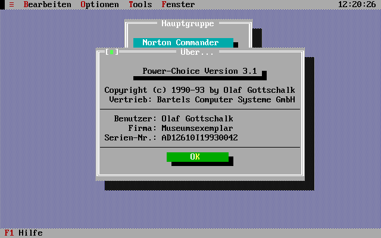 | 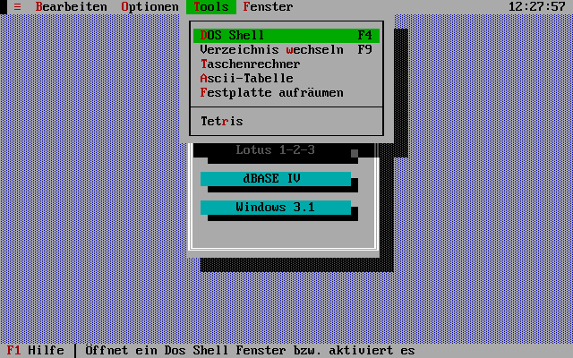 |
| 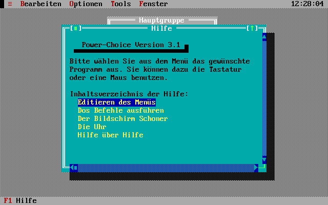 | 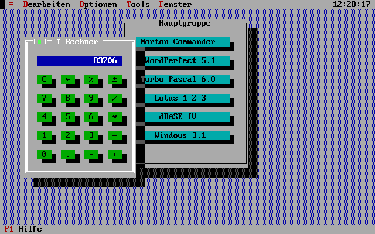 |


*The original 1993 `PCHOICE.EXE` (version 3.1) running in DOSBox-X in 2026.
The menu entries are a reconstruction of a typical installation of the
time. The Tetris game was played by a small program, not by hand: with the
emulator's clock fixed, the game's random pieces could be predicted, and
`tools/tetris-plan.py` planned every move.*

## The story

### Germany: shareware

Power-Choice started in Germany, as the menu that *Bartels Computer
Systeme GmbH* (BCS), run by a distant relative of my mother, installed on the
PCs it sold. I also passed it around as shareware from home in Bad
Nenndorf, with an order form asking for a "suggested donation of $20 or
40 DM".

### Wyoming: Softwhere Associates

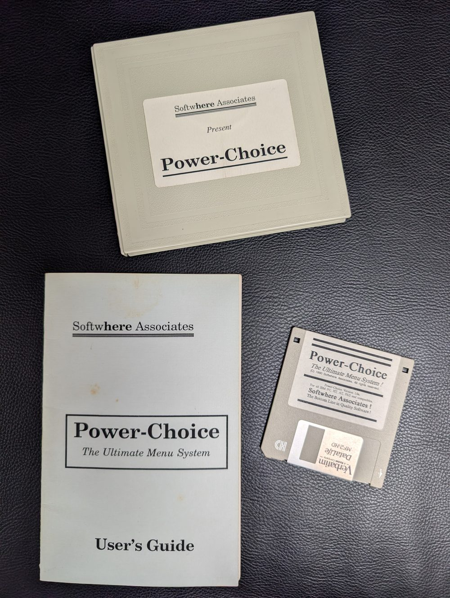

Then I spent a high school year at Evanston High in Evanston, Wyoming,
and graduated there in May 1990. My maths teacher
there was Robert W. Codner, and one of the surviving shareware order forms
is his, dated 2/6/90 ([scan](docs/1990/shareware-order-form.jpg)).
On 29 May 1990, the date of the 1.0e commit in this repository, Bob and I
signed a partnership agreement and founded **Softwhere Associates**. Bob
funded advertising, marketing and distribution from a business account he
had opened with $1,000. Profits were to be split 50/50, or 70/30 in his
favour until the advertising money was back. For a 16-year-old that was a
great feeling. Our letterhead had two addresses, P.O. Box 2061 in Evanston
and Bad Nenndorf, West Germany, and a slogan: *The Bottom Line in Quality
Software!* Bob paid for the Turbo Pascal
license, wrote the documentation with me and handled distribution from
P.O. Box 2061 in Evanston. There was a printed
[flyer](docs/1990/flyer-1.jpg) ([page 2](docs/1990/flyer-2.jpg),
[order form](docs/1990/flyer-3-order-form.jpg)), a boxed package with a
14-page User's Guide ([scan](docs/1990/users-guide.pdf),
[text](docs/1990/users-guide.md)), and a price of
**$29.95** per copy, with site licenses down to $14.98 per seat.

We even placed an [ad in *PC World*](docs/1990/pc-world-ad.jpg) in
September 1990, two columns wide and six inches deep, in the catalogue
section at the back of the magazine. Its toll-free number rang at an
answering service in Evanston, at any hour of any day of the year. The
staff there were excited to take orders, and they answered every call with
"Hello: Softwhere Associates & Math Criterion Center". Math Criterion
Center was Bob's maths-book business.

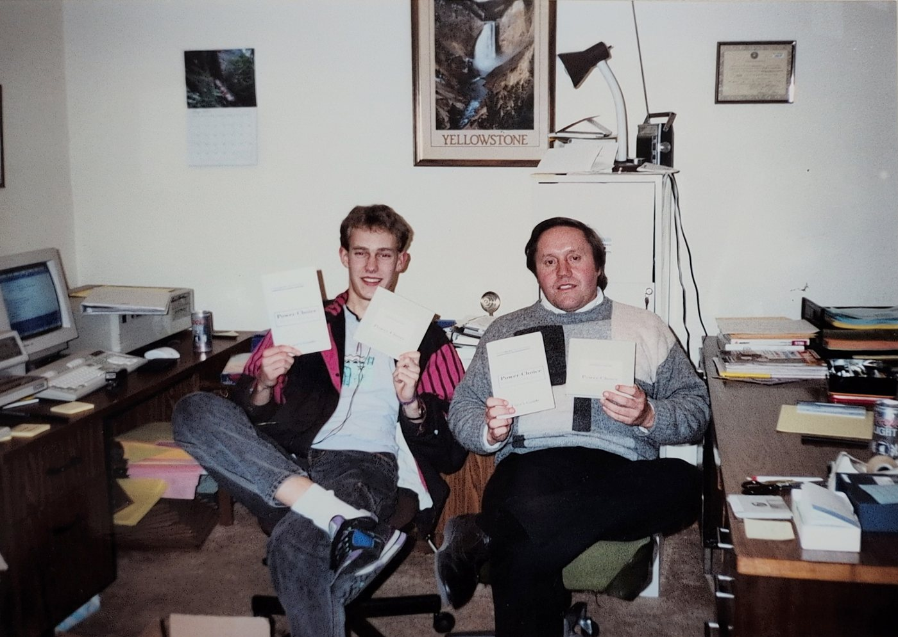

*Softwhere Associates, May 1990, around my graduation from Evanston High:
me (left) and Bob Codner with the finished Power-Choice packages.*

Power-Choice 1.0 is the version from that time: English throughout, with
an installer and a `MAKEDISK` tool that produced numbered distribution
disks. Its Info box still reads:

```
Power-Choice Version 1.0e
(C) 1990 Softwhere Associates

Programming+Design : Olaf Gottschalk
Documentation      : Robert W. Codner
                     and Olaf Gottschalk
───────────────────────────────────────────────────
 Special Thanks to my parents who gave me a chance
   to experience more than I ever expected !
                     Olaf Gottschalk, May '90
```

No executable of 1.0 has survived, but the flyer and the User's Guide
show what it looked like:

<a href="docs/1990/flyer-1.jpg">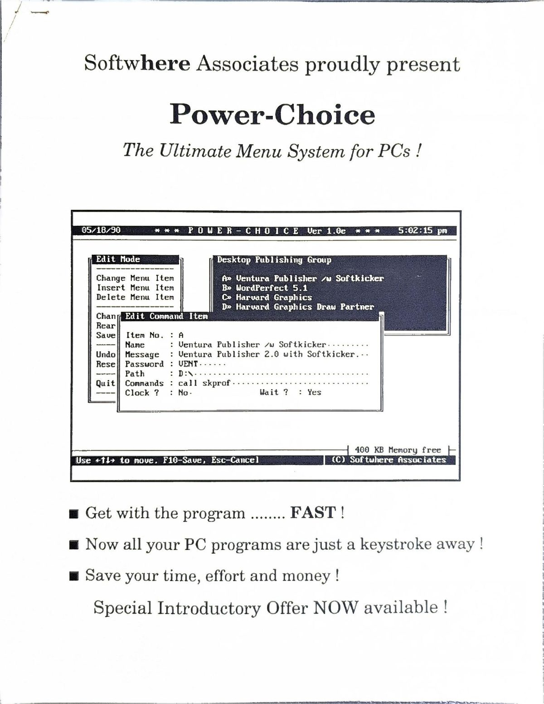</a>

### 1.0e, rebuilt in 2026

Everything 1.0e needs did survive, so it can be built again: Borland
released Turbo Pascal 5.5, the compiler from May 1989 that I used, as free
"antique software", and the resident driver assembles with JWasm, an
open-source MASM clone. `tools/build-1.0e.sh` turns the sources at tag
`v1.0e` into the distribution disk in [`v1/disk`](v1/disk):
`PCHINST.EXE` and `PCHOICE.DAT`, the container that my own `PREINST`
program packed `PCHOICE.EXE` and `PCH_LL.COM` into. The build is
reproducible to the byte.

Installed from that disk in DOSBox-X, it looks like this, here in colour
next to the black-and-white screenshots of 1990. For the comparison the
DOS clock was set to the date and time of the flyer's screenshot,
05/18/90 around 5 pm:

| | |
|---|---|
|  | 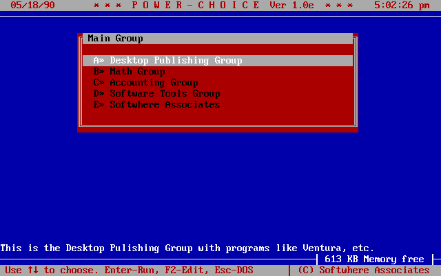 |
| 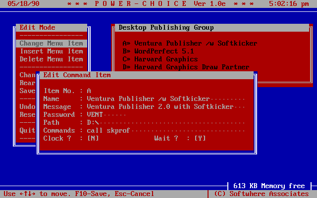 | 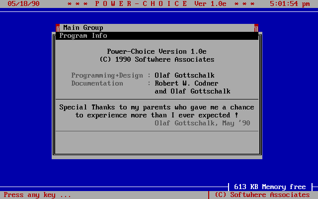 |

In motion: the installation from the floppy, at roughly the speed of a
1990 PC, ending with `PCH_LL` loading and its clock appearing in the top
right corner of the DOS screen ...

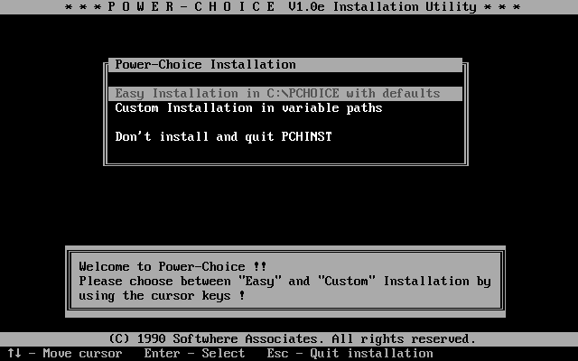

... and a tour: the menu with its help line, the Program Info, the Edit
Mode, then *Esc* to DOS, where the resident clock keeps running, and
`PCH` to come back, just as the User's Guide describes.

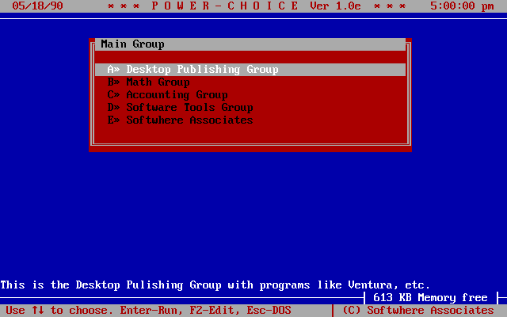

### Back in Germany: Turbo Vision

Back home, Power-Choice was rewritten from scratch on Turbo Vision.
Versions 3.x are German again and were distributed by BCS, as their
About box says.

## Looking back

### How it started

My first programming language was UCSD Pascal, on an Apple II. My first PC
was an XT clone with an 8088, which I soon upgraded to a NEC V20. The
`V20.INC` in the 1.0 sources still holds the macros for the extra
instructions that the V20 knew and my assembler didn't. The whole family
shared that PC and its 20 MB hard disk, and Power-Choice began as a way to
help my father and my younger brothers get to their programs without
typing DOS commands.

At fifteen or so I had picked up the idea of shareware and liked it. It
never went anywhere, because nobody knew about it. BCS did go somewhere:
Bartels Computer Systeme was run by a distant relative of my mother. I did
an internship there, and Power-Choice ended up on the PCs they sold. I
can't remember what they paid me for it.

### Wyoming

In 1989 the exchange organisation GIVE placed me with a family in
Evanston, Wyoming. Their computer was hooked up to the TV and was weaker
than a Commodore VIC-20; all I could do on it was play Donkey Kong. So I
looked for a better computer at school. In the computer class, *Pascal 2*,
every student had an Apple II, the machine my journey had started on. The
teacher soon noticed that I already knew everything he planned to teach,
and gave me a seat at the side, at the only IBM in the room, a PS/2. While
the class learned Pascal, I worked on my own projects.

I met Bob Codner while looking for a maths class that could still teach me
something. In the first weeks I moved up the ladder a few times and ended
up in Calculus AB. Bob soon heard that I "did my own thing" in the computer
lab. One day I gave him a copy of Power-Choice, and founding Softwhere
Associates to make it a product was his idea. At sixteen, that felt great.

The last work on 1.0e happened in the final months of my year, on Bob's
386. It was by far the most powerful computer I had ever seen, and next to
it stood another gadget I loved: a laser printer. Bob was a teacher and a
salesman, he sold maths books to other teachers, and his office was set up
for it. I had already translated the program into English; on his PC I did
the final clean-up. And Bob bought Turbo Pascal 5.5 Professional from
Borland, which Softwhere then owned. My luggage home was heavy enough
already: I was carrying an old half-height 10 MB hard disk, to give our XT
50% more capacity, plus a floppy drive. So in August Bob sent the Pascal
package after me by air mail, "$54 just for the postage!!" It was my first
legal Turbo Pascal, with objects. In 2026 the same version of that
compiler rebuilt 1.0e from the source in this repository.

At home I kept working on Power-Choice and sent Bob a new version. He
liked the mouse support, and was relieved that I had already fixed a
problem he had written to me about urgently. Bob also had the next product
in mind. On 12 August 1990 he sent me four pages of specifications for a
test generator for maths teachers, from Basic Math to Calculus BC. It
would shuffle the questions into several versions of one test ("a BIG
marketing feature") and print them on a laser printer. "I'll leave the
design of the different screens to you; you are good at that." He also
turned down my name for it: "Power Test is OK but I think we have enough
Power already." I started on it, but it never got far, and nothing of it
survives.

Power-Choice was never a financial success. The ad cost $5,500. It was
black and white, packed in among the many ads at the back of the issue,
and in October Bob wrote that it had brought four sales and 24 requests
for brochures. A few callers wanted to see a demo first. Counting the
copies Bob sold to people he knew, we sold maybe half a dozen. And Bob had
seen it coming. In August 1990, explaining the expensive ad, he wrote: "I
figure we needed to make a bold move since 'Windows' is the up & coming
thing and will probably make menus obsolete in time. Do you agree??" He
didn't give up, though: "Remember: my books did not sell at first
either!!"

One customer, the PC coordinator of a bank, sent the program back for a
refund: "After modifying the PCH batch file to include the low-level
driver it would not keep the changes." Bob forwarded it with a question of
his own: what did she mean by the "low-level driver"? Looking back, it was
my first meeting with a problem that has stayed with me ever since: a bug
report tells you what someone saw, not what they did. My best guess is
that she added `PCH_LL`, the resident part, to `PCH.BAT` by hand. But the
installer loads `PCH_LL` from `AUTOEXEC.BAT`, and `PCH.BAT` is a file
nobody should ever touch: Power-Choice rewrites it every time it starts a
program, so her change was bound to disappear.

We lost contact in 1991. A lot happens when you come home from a year
abroad, and I lost touch with almost everyone in Evanston. I still wonder
whether I could reconnect, and who is still alive.

### Back in Germany

I came back from the USA in June 1990, a few weeks shy of 17. Approaching
my 18th birthday, I got a real contract with BCS, and I kept working for
them alongside university. BCS was a local
Compaq dealer whose customers were small and medium-sized offices, and
networks were the hot topic: Novell was installed everywhere. That is
where the network edition 3.1n comes from: one menu, managed centrally for
all the PCs of an office.

The 3.0 rewrite came from Turbo Vision. I was amazed when Borland released
this "graphical" user interface, and I spent quite some time learning
everything about this new thing called OOP. ;-) User interfaces were a
very good playground for objects.

Then Windows arrived, just as Bob had predicted in 1990, and Windows was
the end of every menu program of the time. We were simply too late to the party.

### Afterwards

I studied electrical engineering, but that was a side quest. I stayed a
programmer, and I still am. During my studies I wrote custom software, some
of it for BCS and some on my own: warehouse and order management for a
chain of kiosks, a client database for a lawyer, and once the
reconstruction of the book list of a library that had burned down. To get
its insurance money, the library had to recover partial data from
relational database systems that no longer ran. All of it in Pascal, and
later in Delphi.

### Reading it again

Reading my code from back then, more than 30 years later, I am honestly a
bit amazed. I think I can see my clean code style emerging. What I can't
see is a single test: unit testing was not something I had learned, and I
wonder whether it was a thing at all in 90s Pascal.

My message to the kid at Bob's 386: keep it up. That 386 is by far not it!

### A code review, 36 years late

*Olaf asked Claude for a review of the sources in `v1/` and `v3/`. Here it
is.*

**Verdict: approved, with comments.**

What works:

- **Objects from day one.** In 1990 `PCH_DEF.PAS` already models the menu
  as objects: `Item`, `Group` and `MenuObj`, each with
  `Init`/`Done`, `ReadF`/`WriteF`, `Edit` and `Run`. That is Turbo
  Pascal 5.5, the first version with objects at all, released only the
  year before.
- **Names that say what they do**, such as `SwitchGroup`,
  `ChangePasswords` and `OpenBatchFile`. Reading the code in 2026 rarely
  required guessing.
- **The 3.0 rewrite is a real class hierarchy.** `TMenuItem` with
  `TDosItem` and `TGroupItem` below it, virtual `Execute` and `Edit`, and
  `Load`/`Store` on Turbo Vision streams. Option bits are named constants
  (`miClock`, `miScreensaver`, `miWait`), and error codes too
  (`PathNotFound`, `BatchFileError`). This is what the 1.0 code wanted to
  be.
- **Close to the metal, but documented.** `Max` and `Min` are five
  instructions of inline machine code, with the assembly written next to
  every byte.

Requested changes:

- **Comments.** `PCH_DEF.PAS` has 1,368 lines and not a single comment;
  `PCHMENU.PAS` in 3.x has 8 in 977 lines. The names carry a lot, but the
  batch-file loop and the handshake with the resident part had to be
  reconstructed from the code.
- **Magic numbers** in 1.0: `PutMsg(5)`, `Case C^.Typ Of 0`, `256+72` for
  cursor up. 3.0 fixed this; 1.0 still needs it.
- **`Goto Done`**, six times in `INSTALL.PAS`. A cleanup path from before
  Pascal had `try`/`finally`. Forgiven.
- **Tests: none.** Also forgiven. Kent Beck's SUnit for Smalltalk came in
  1994, JUnit in 1997, DUnit for Delphi around 2000. In 1990 the test
  suite for a menu program was your younger brothers.

Verified: in 2026 it still compiles with Turbo Pascal 5.5 and runs. Ship
it.

## As seen on TV… almost

[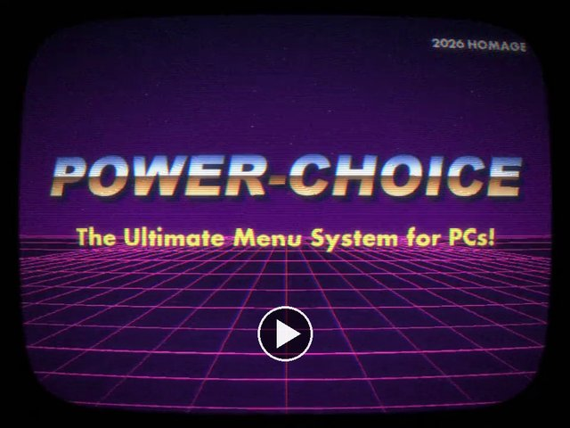](docs/tv-ad/powerchoice-ad.mp4)

Softwhere Associates never had a TV commercial. In 2026 it got one
anyway: 39 seconds in the style of an American late-night ad of 1990,
seen on a curved CRT, with the slogans of the original flyer. The DOS
scenes use the real VGA font, the product shots show the real 1.0e and the
1990 package, a synthetic narrator ("Reed") sells, and the classic Mac
voice "Fred" plays the computer that answers *Bad command or file name*.
The jingle is synthesized. The spot is marked as a 2026 homage throughout,
and the 800 number on the end card is a fictional 555 number.
`tools/tv-ad/make.sh` makes it from scratch on a Mac.

## Version history

1.0e and 3.x share little more than the name: 3.0 was written from
scratch, and less than 1% of its code also appears in 1.0e. They therefore
live side by side, in [`v1/`](v1) and [`v3/`](v3). Each version is one
commit, dated with the timestamp of the newest file in the archive it came
from, and tagged; `git log v3/` shows how 3.x evolved:

| Tag | Date | What happened |
|---|---|---|
| [`v1.0e`](../../tree/v1.0e) | 1990-05-29 | The US edition by *Softwhere Associates*. Turbo Pascal 5.5 with a home-grown text-mode window library (`DESKTOP.PAS`), a hypertext help viewer, an installer, a disk-building tool and a resident low-level driver in MASM. |
| [`v3.0`](../../tree/v3.0) | 1992-10-03 | Back in Germany: complete rewrite on Borland's Turbo Vision, distributed by BCS. Menu groups, password driver, screen savers for EGA/VGA, CGA and Hercules, Tetris, a calendar and the *Kobold* file manager. |
| [`v3.01`](../../tree/v3.01) | 1993-08-26 | First `MAKEFILE`; calendar and file manager removed again. |
| [`v3.02`](../../tree/v3.02) | 1993-09-06 | Cleanup, reworked drivers. |
| [`v3.1`](../../tree/v3.1) | 1993-09-13 | Registration, group and program editors, hard-disk cleanup, much larger online help. |
| [`v3.1n`](../../tree/v3.1n) | 1994-01-17 | Network edition: shared program directory (`PCHGLOBAL`) and per-user settings (`PCHUSER`). |

Neither the original German versions from before the US year nor any 2.x
version have survived.

## How it worked

Power-Choice 3.x is a [Turbo Vision](https://en.wikipedia.org/wiki/Turbo_Vision)
application written in Turbo Pascal 6.0, using overlays to fit into 640 KB,
with all dialogs, menus and strings kept in a Turbo Vision resource
file that is appended to the EXE. Some details that were typical for the time:

- **Three programs instead of one.** `PCHPW.SYS` is a device driver,
  loaded as the first line of `CONFIG.SYS`, that asks for the system
  password before DOS has even finished booting. `PCHEGA.COM` (or its
  CGA/Hercules siblings) is a TSR that draws the clock, blanks the screen
  after a while and keeps Power-Choice's state between runs; the menu finds
  it through interrupt vector `60h` and refuses to start without it.
  `PCHOICE.EXE` is the menu itself.
- **Getting out of the way.** A DOS program can't run another one while
  using all the memory itself. Power-Choice therefore writes the commands
  of the chosen menu entry into `PCH.BAT`, exits, lets the batch file run
  them, and is restarted by a `GOTO $AGAIN` at the end. A "quick" mode
  shrinks the heap and runs small programs directly instead.
- **Copy protection.** `REGISTER.EXE` searches `PCHOICE.EXE` for the
  marker `USERREG` and patches in the owner's name, company and serial
  number, lightly encrypted. An unregistered copy proudly shows
  *„Serien-Nr.: ! RAUBKOPIE !"* ("pirated copy") in its About box.

## Repository layout

```
v1/             Power-Choice 1.0e (1990, Softwhere Associates, English)
  src/          source code
  disk/         distribution disk, rebuilt from src/ in 2026
v3/             Power-Choice 3.x (1992-1994, BCS, German)
  src/          source code, 3.1n at HEAD
    ASM/        low-level drivers (Turbo Assembler, IDEAL mode)
    REZFILES/   dialogs, strings and help text for the resource file
  bin/          compiled 3.1 distribution, byte for byte as archived
docs/           browser demo (index.html, play/), screenshots, recordings,
                the TV spot (tv-ad/),
                and in docs/1990 the Softwhere Associates
                flyer, ad, order forms, User's Guide (scan and text) and
                package photo
tools/          the helpers used in 2026 for screenshots, recordings, the
                1.0e rebuild, the TV spot (tools/tv-ad) and the social
                preview image
```

To look at an older 3.x version, check out its tag, e.g. `git checkout v3.0`.

## Running it

The easiest way is the [browser demo](https://zordid.github.io/powerchoice/)
(`docs/index.html`, served by GitHub Pages from the `docs` folder): both
versions, ready to use, in [js-dos](https://js-dos.com). The demo bundles in
`docs/play` were made with `tools/make-bundle.py` from the same states as
the screenshots: 1.0e installed from `v1/disk` with the menu of the 1990
flyer, and 3.1 with the demo menu, registered with its own `REGISTER.EXE`.

The menu entries start stand-ins instead of the real programs of the time
(`tools/standin.asm`): one small program that names itself after its file
(`WP.COM` says it stands in for WordPerfect 5.1) and returns on any key. So
the demo shows Power-Choice stepping aside through `PCH.BAT`, the resident
clock drawn over another program, and, in 3.1, the screen saver. For the
demo, the copy of `PCHEGA.COM` in the bundle waits one minute instead of
five before switching the screen off: one word changed, at offset 31; the
original in `v3/bin` is untouched. 3.1 runs on js-dos's DOSBox-X core,
because the plain DOSBox core does not emulate the VGA blanking the screen
saver uses.

To run it locally instead:


Copy the contents of `v3/bin/` into a directory, mount it in
[DOSBox-X](https://dosbox-x.com/) or [DOSBox](https://www.dosbox.com/) as
`C:\PCHOICE` (the path is built in), and start:

```
C:\PCHOICE> PCHEGA
C:\PCHOICE> PCHOICE
```

The first start complains that there is no menu file yet. Use
*Bearbeiten → Editmodus* (F2) and F3 to add entries; Alt-X saves them to
`PCHOICE.MNU` on exit. `PCHPW.SYS` can be loaded with `DEVICE=` in a
DOSBox-X `CONFIG.SYS` if you want the boot-time password prompt as well.

For 1.0e, mount `v1/disk` as a floppy and install it like in 1990
(choose *Custom Installation*: *Easy* reboots the machine at the end):

```
Z:\> MOUNT A path/to/v1/disk -t floppy
Z:\> A:
A:\> PCHINST
A:\> C:\PCHOICE\PCH_LL
A:\> C:\PCHOICE\PCHOICE
```

F1 shows the Program Info, F2 enters the Edit Mode.

## Building it

**1.0e** builds from this repository with `tools/build-1.0e.sh`, given
Borland's `tp55.zip` and a JWasm binary (see the script).

**3.x** can't be built from this repository alone. `v3/src/MAKEFILE` expects Turbo
Pascal 6.0, Turbo Assembler, `TVRM` and `TVHC`. Power-Choice also used several units
of my own that were kept elsewhere and have not survived: `StrUtl`,
`StrObj`, `TextObj`, `DateUtl`, `DosTools`, `HintStat` and `Editor`. They
were a shared library: the 1993 Kiosk project on the same backups uses
them too and does not contain them either. `Fields` turned up in that
project and is now in `v3/src`. `Calc`, `Gadgets`, `HelpFile` and
`AsciiTab` came from Borland's Turbo Vision demo programs.

## Notes on this archive

- **Sources:** `PCH3-00.ARJ` … `PCH3-10B.ARJ` and `Pch1-00.zip`, found on
  backup CDs. The file contents are unchanged except that text files
  were converted from code page 437 to UTF-8 (so umlauts and box-drawing
  characters show up on GitHub) and the DOS end-of-file marker (`^Z`) was
  removed. Line endings are still CRLF. To build in DOS again, convert back
  with `iconv -f UTF-8 -t CP437`.
- **Recovered:** `v3/src/FIELDS.PAS` was not in the Power-Choice
  archives. It comes from `KIOSK12C.ARJ` (8 June 1993), a project for a
  chain of kiosks on the same backups, and is the unit Power-Choice 3.x
  uses: the stream IDs it registers match `PCHOVR1.PAS`. It is ASCII and
  unchanged.
- **Not included:** compiled intermediates (`.TPU`, `.OBJ`, `.EXE` built
  from the tree), Turbo Pascal IDE state (`TURBO.TP`, `TURBO.DSK`), and
  third-party files that were lying around in the 1.0 directory:
  IBM's `VDISK.ASM` sample driver, the Microsoft MASM 5.0 macro files
  `MIXED.INC`, `DOS.INC` and `BIOS.INC`, and Borland's unmodified
  `OBJECTS.PAS` demo unit, which is part of the free Turbo Pascal 5.5
  download.
- **1990 documents:** scanned from my own papers. On Bob's order form,
  his street address, phone number and signature are blacked out; my own
  old street address is blacked out on the order form and the flyer.
- **Screenshots and recordings:** made by loading a small TSR
  (`tools/scrdump.asm`) next to Power-Choice that types keystrokes from a
  script into the BIOS keyboard buffer and saves the text screen at a fixed
  rate (once per second for screenshots, about 4.5 times per second for
  recordings). `tools/keys.py` compiles the key scripts, `tools/render.py`
  turns the dumps into PNGs using the VGA ROM font, and `tools/gif.py` into
  animated GIFs. Nothing is retouched: every pixel comes from the text
  screen Power-Choice actually drew.
- **Social preview:** `docs/social-preview.png`, the picture GitHub and
  chat apps show for links to this repository and the demo, is not a
  screenshot. It is a 2026 composition in the style of 1.0e, drawn by
  `tools/social-preview.py` as a 160×40 text screen in the same VGA font.

## Third-party code

Not everything in this repository is mine:

- `v1/src/FORMS.PAS` is Borland's `FORMS.PAS` demo unit from Turbo
  Pascal 5.5, Copyright (c) 1989 Borland International, with a few changes
  of mine (no window coordinates, a different colour). It needs Borland's
  `OBJECTS.PAS` from the same demo set, and only the `MAKEDISK` tool uses
  it; Power-Choice itself does not. Borland made Turbo Pascal 5.5 free to
  download, but it is not open source, so this file is not covered by the
  MIT license.
- `v3/src/FIELDS.PAS` is Borland's `FIELDS.PAS` from the Turbo Vision
  forms demo of Turbo Pascal 6.0, Copyright (c) 1990 Borland
  International, with `TRealInputLine` added by me. It is not covered by
  the MIT license either.
- `docs/play/js-dos` is an unmodified excerpt of js-dos 8.5.3 by
  Alexander Guryanov, with its DOSBox and DOSBox-X cores, GPL-2.0; see its
  [notice](docs/play/js-dos/NOTICE.md).
- `v3/src` uses Turbo Vision and its demo units (`Calc`, `Gadgets`,
  `HelpFile`, `AsciiTab`) by Borland; they are not included.

## License

[MIT](LICENSE), for everything I wrote; see *Third-party code* for the
exceptions. The names of products shown in the screenshots belong to their
respective owners.
